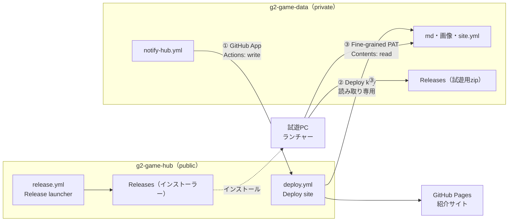
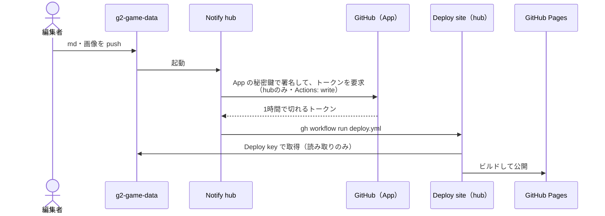
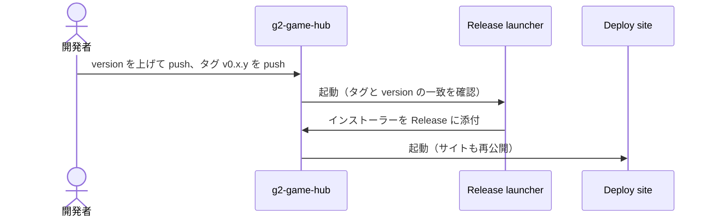
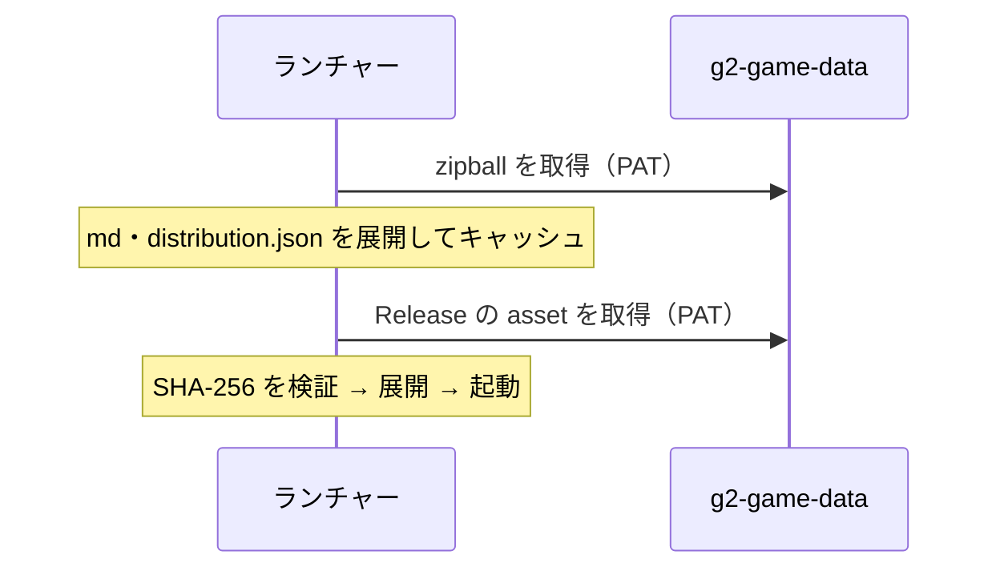

# リポジトリの連携とCI

手順そのものは [運用](operations.md) にあります。この文書では「何がどこにつながっていて、なぜその設定が要るのか」をまとめます。

## 全体の連携

| 番号 | 誰が | 何に | 使う資格情報 | 置き場所 |
|---|---|---|---|---|
| ① | dataの `notify-hub.yml` | hubの「Deploy site」を起動 | GitHub App の秘密鍵 → 1時間で切れるトークン | dataの Secrets |
| ② | hubの `deploy.yml` | dataのリポジトリを取得 | Deploy key（SSH鍵） | 公開鍵：dataの Deploy keys／秘密鍵：hubの Secrets |
| ③ | ランチャー | dataのzipballとReleaseを取得 | Fine-grained PAT | 試遊PCの資格情報ストア |

それぞれ **別の鍵で、できることを1つに絞っています**。どれか1つが漏れても、ほかには広がりません。

## ワークフロー

| ワークフロー | リポジトリ | 動くとき | すること |
|---|---|---|---|
| Notify hub（`notify-hub.yml`） | data | `main` へのpush（下記の除外を除く）、手動 | hubの Deploy site を起動する |
| Deploy site（`deploy.yml`） | hub | タグ `v*` のpush、手動、Notify hub から | dataを取得してサイトをビルドし、Pages に公開する |
| Release launcher（`release.yml`） | hub | タグ `v*` のpush | Windows用インストーラーを作り、hubの Release に添付する |

Notify hub が**動かない**変更：`games/*/distribution.json`、`README.md`、`AGENTS.md`、`docs/**`、`.github/**`、Release の作成・更新。どれもサイトの表示に関係しないためです。hubの `main` へのpushでも、何も動きません。

### dataを更新したとき

### ランチャーを更新したとき

### ランチャーがゲームを取得するとき

ランチャーは実行時にdataを直接読むので、**dataの更新でランチャーを作り直す必要はありません**。

## 設定の一覧

| リポジトリ／場所 | 種類 | 名前 | 中身 |
|---|---|---|---|
| hub | Secret | `CONTENT_DEPLOY_KEY` | Deploy key の秘密鍵 |
| hub | Variable | `CONTENT_REPOSITORY` | データリポジトリ（`owner/name`） |
| hub | Pages | Source | GitHub Actions |
| data | Deploy key | `g2-game-hub site build` | 公開鍵（書き込みなし） |
| data | Secret | `HUB_APP_PRIVATE_KEY` | GitHub App の秘密鍵（.pem） |
| data | Variable | `HUB_APP_CLIENT_ID` | GitHub App の Client ID |
| data | Variable | `HUB_REPOSITORY` | hub のリポジトリ名（owner なし） |
| Organization | GitHub App | `g2-hub-notifier` | Actions: Read and write のみ、Webhook・Device flow なし、hubにだけインストール |
| Organization | PATのポリシー | — | Classic の禁止、期限の上限、承認制（[任意](#任意の設定)） |
| 試遊PC | 資格情報ストア | `jp.g2.game-launcher` | ランチャー用の Fine-grained PAT |

鍵ファイル（Deploy key・.pem）は、登録したら手元から削除します。もう一度必要になったら、作り直します。

## 漏れたとき・人が抜けるとき

| もの | 漏れたときにできること | 対処 |
|---|---|---|
| ランチャーのPAT | dataとReleaseの読み取り | 失効させ、新しいPATを発行 |
| Deploy key | dataの読み取り（Releaseは不可） | dataの Deploy keys から削除し、作り直す |
| Appの秘密鍵 | hubのワークフローの起動のみ（dataは読めない） | App の `Credentials > Key pairs` で鍵を削除し、作り直す |

## 採用しなかった方法

| 方法 | 採用しなかった理由 |
|---|---|
| ランチャーで GitHub にログイン（Device flow） | GitHub が推奨しておらず、フィッシングに使われやすい |
| client_secret や App の秘密鍵をランチャーに入れる | 配布物から取り出せる |
| サイトのビルドに PAT を使う | 個人に依存し、期限が切れるたびに更新が必要 |
| hub の `main` への push でデプロイ | 意図しない公開を避けるため、タグと手動に限定 |

## 任意の設定

Organization の `Settings > Personal access tokens` のポリシー（Classic の禁止、期限の上限、承認制）は、なくても動きます。PATを人の運用で守る（Fine-grained で作る、イベント後に失効させる）のを、仕組みで強制するためのものです。メンバーが運用に加わる前に設定することをおすすめします。

## 導入の記録

2026-11 の初回導入で行ったこと。状態が変わったら更新してください。

- [x] 2つのリポジトリを作成し、push
- [ ] Deploy key の登録（data の Deploy keys、hub の Secret・Variable）
- [ ] Pages を GitHub Actions に設定し、Deploy site を手動で実行して表示を確認
- [x] GitHub App `g2-hub-notifier` の作成
- [ ] App の秘密鍵の作成（`Credentials > Key pairs > New key`）、hub へのインストール、data への登録
- [ ] Notify hub の手動実行と、push での自動反映を確認
- [ ] Organization の PAT のポリシー（任意・保留中）
- [ ] テスト用ゲームの Release と `distribution.json`、ランチャー用 PAT の発行
- [ ] Windows でランチャーの動作を確認
- [ ] タグ `v0.1.0` でインストーラーを作成

GitHub の画面の注意：2026-11 時点では、App の秘密鍵は `Generate a private key` ではなく、App の設定の `Credentials > Key pairs > New key` で作ります。`Client secrets` は使わないので作りません。
